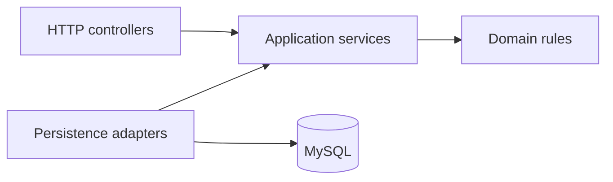

# Internal Transactions System

A small backend-only transaction processing project built with Java 21, Spring Boot 3, and MySQL 8.

## Run locally

Prerequisites: Java 21 and Docker Compose. Maven is provided by the project wrapper.

```sh
docker compose up -d --wait
./mvnw spring-boot:run
```

The API runs at `http://localhost:8080`; health is available at `http://localhost:8080/actuator/health`.
OpenAPI JSON is available at `http://localhost:8080/v3/api-docs`, and Swagger UI at `http://localhost:8080/swagger-ui/index.html`.

For funded demo accounts, run the service with the explicit `local-demo` profile:

```sh
SPRING_PROFILES_ACTIVE=local-demo ./mvnw spring-boot:run
```

The fixture seeds two MXN accounts only when the database has no accounts and logs their IDs. Their opening balances are demo-only and are not recorded in the transfer ledger.

For an uncertain transfer response or a `500` processing error, retry the same request with the same `Idempotency-Key`. A stored `422` business rejection is replayed; use a new key if the request details change.

Local database credentials have development-only defaults in `compose.yaml`. To override them, copy `.env.example` to `.env`. To stop MySQL while preserving its data, run `docker compose down`; to delete the local database volume as well, run `docker compose down -v`.

Run the test suite with:

```sh
./mvnw -B verify
```

HTTP/persistence tests use the MySQL service above. The concurrency suite starts an isolated MySQL container with Testcontainers, so `./mvnw -B verify` also requires Docker.

## Project structure

Code is organized under `io.github.gdpe_franco.internaltransactions` into domain, application, infrastructure, and web packages. See [ARCHITECTURE.md](ARCHITECTURE.md) for the layer boundaries and the transfer, money, idempotency, and concurrency decisions.

Account numbers use an 18-digit synthetic CLABE format for this demo only. They are not bank-issued and cannot be used for SPEI or external payments.

## API examples

Create an account:

```sh
curl -i -X POST http://localhost:8080/api/v1/accounts \
  -H 'Content-Type: application/json' \
  -d '{"ownerName":"Ada Lovelace","currency":"MXN"}'
```

Funded source/destination IDs are printed when starting with the `local-demo` profile. Transfer 25 MXN (use a fresh UUID for each new attempt):

```sh
curl -i -X POST http://localhost:8080/api/v1/transfers \
  -H 'Content-Type: application/json' \
  -H 'Idempotency-Key: 3e502592-76af-44c6-9ca7-120e36aa46cf' \
  -d '{"sourceAccountId":1,"destinationAccountId":2,"amount":25.00,"currency":"MXN"}'
```

Read the transfer and an account's ledger:

```sh
curl -i http://localhost:8080/api/v1/transfers/1
curl -i 'http://localhost:8080/api/v1/accounts/1/ledger?page=0&size=50'
```

## Architecture at a glance



Transfers write both balances, the transfer outcome, and both ledger entries in one MySQL transaction. `Idempotency-Key` retries replay the existing result; a key reused with different request details conflicts. Pessimistic account locks are acquired in ascending ID order. See [ARCHITECTURE.md](ARCHITECTURE.md) for the accepted failure and recovery behavior.
