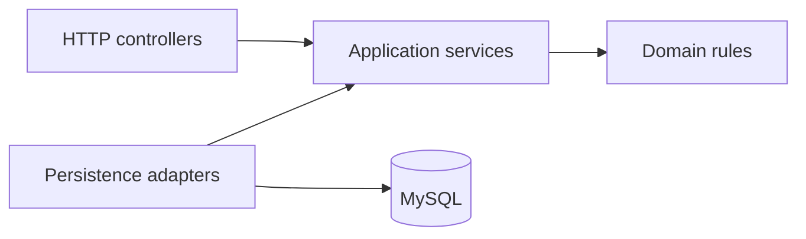

# Internal Transactions System

A small backend-only transaction processing project built with Java 21, Spring Boot 3, and MySQL 8.

## Run locally

From the repository root, one command builds the app image and starts the API and MySQL. Docker supplies Java and Maven; neither needs to be installed on the host.

```sh
docker compose up -d --build --wait
```

API: <http://localhost:8080>
This MVP has no authentication. Compose binds the API and MySQL ports to localhost only; the `Idempotency-Key` header is not an access credential.
- Health: <http://localhost:8080/actuator/health>
- Swagger UI: <http://localhost:8080/swagger-ui/index.html>
- OpenAPI JSON: <http://localhost:8080/v3/api-docs>

Flyway applies database migrations at startup. View app logs with `docker compose logs -f app`.

To start with funded demo accounts (only seeds an empty database):

```sh
SPRING_PROFILES_ACTIVE=local-demo docker compose up -d --build --force-recreate app
```

The fixture logs the account IDs. Opening balances are demo-only and are not ledger entries.

Run all tests, including the Testcontainers concurrency tests:

```sh
docker compose --profile test run --rm test
```

Stop the app and database while preserving data with `docker compose down`. Delete the local database volume as well with `docker compose down -v`. You can override local-only database defaults by copying `.env.example` to `.env`.

For an uncertain transfer response or a `500` processing error, retry the same request with the same `Idempotency-Key`. A stored `422` business rejection is replayed; use a new key if transfer details change.

## Project structure

Code is organized under `io.github.gdpe_franco.internaltransactions` into domain, application, infrastructure, and web packages. See [ARCHITECTURE.md](ARCHITECTURE.md) for the layer boundaries and the transfer, money, idempotency, and concurrency decisions.

Account numbers use an 18-digit synthetic CLABE format for this demo only. They are not bank-issued and cannot be used for SPEI or external payments.

## API examples

Create an account:

```sh
curl -i -X POST http://localhost:8080/api/v1/accounts \
  -H 'Content-Type: application/json' \
  -d '{"ownerName":"Ada Lovelace","currency":"MXN"}'
```

Funded source/destination IDs are printed when starting with the `local-demo` profile. Transfer 25 MXN (use a fresh UUID for each new attempt):

```sh
curl -i -X POST http://localhost:8080/api/v1/transfers \
  -H 'Content-Type: application/json' \
  -H 'Idempotency-Key: 3e502592-76af-44c6-9ca7-120e36aa46cf' \
  -d '{"sourceAccountId":1,"destinationAccountId":2,"amount":25.00,"currency":"MXN"}'
```

Read the transfer and an account's ledger:

```sh
curl -i http://localhost:8080/api/v1/transfers/1
curl -i 'http://localhost:8080/api/v1/accounts/1/ledger?page=0&size=50'
```

Ledger responses contain an `entries` array and `page` metadata: the zero-based `number`, `size`, `totalElements`, and `totalPages`.

## Architecture at a glance



Transfers write both balances, the transfer outcome, and both ledger entries in one MySQL transaction. `Idempotency-Key` retries replay the existing result; a key reused with different request details conflicts. Pessimistic account locks are acquired in ascending ID order. See [ARCHITECTURE.md](ARCHITECTURE.md) for the accepted failure and recovery behavior.
